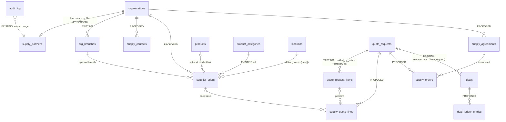

# HagerLand Supply: commercial intelligence blueprint (Ethiopia)

Status: **blueprint only**. Nothing in this document has been built. Written 23 Oct 2026 on branch `docs/supply-intelligence-blueprint`, from `main` at `536229c`.

How to read it:

- **Verified fact** means checked by reading the code, the migrations or an existing test in this repository. The file is named.
- **Proposal** means a suggestion that has not been built.
- **Assumption** means a decision taken so the work could continue. Every assumption is listed again in Section 13.
- Legal and business points about Ethiopia are things to consider and check with a professional. They are not legal advice.

---

## 0. For AB (one page)

**What we have today.**

A customer can send a materials list or a quote list. The pages are `/supplies/materials-list` and `/supplies/quote`. HagerLand gets an email, and the request appears in admin → Quotes with a reference like HLQ-2026-000003. You type a total and upload a quote PDF that you made somewhere else. The customer gets an email and can download the PDF from their account. Then you mark the quote Accepted, Declined and so on. The site also already has:

- **Organisations**: businesses, with phone, WhatsApp, Telegram, trade licence number, TIN and a merge tool for duplicates.
- **Products**: with units such as quintal and bag, and a price CSV upload.
- **Trade accounts.**
- **Exchange rates.**
- **Deals and commissions**: a simple money list you can link to an HLQ quote.
- **Demand**: a report.
- **Imports**: finds businesses on Google.

**What is missing.** All of the following happens in your head, on WhatsApp or in spreadsheets today:

- Which shops sell which materials, and at what price on what date.
- Who you spoke to there.
- What you agreed with each partner.
- What you ordered for a customer, and whether it arrived.
- What you earned.

**What the intelligence layer would add.** It is a private notebook inside the admin, never seen by the public. It would hold:

1. A list of supply partners, each with its phone-first contacts, its verification evidence and where you are with it (contacted, interested, active, and so on).
2. Dated price lists for each partner, so you can see the cheapest fresh price for cement in Bole today.
3. For each customer quote: the items, which partners you asked and what they quoted.
4. What you ordered, the delivery photo and any problems.
5. What you expect to earn and what has been paid, under either money model.

**What it would earn.** It earns nothing by itself. It makes each quote faster and cheaper to produce, and it stops margin or commission from being forgotten. It also shows which partners are reliable. Today every quote is rebuilt from scratch, so faster quoting means more quotes answered and more won.

**Recommended first step.** One small job: a private "Supply partner" record for each supplier organisation (relationship status, roles, contacts, verification, source), with one new list screen. It needs one small, additive database change that you would run, as with earlier migrations. It changes nothing on the public site. Details are in Section 12.

**What you must decide** (full list in Section 13):

- **Money model A or B, or both.** In A, the customer pays HagerLand and HagerLand pays the partner. In B, the customer pays the partner and the partner pays HagerLand a commission. The design supports both, so you can decide later, but before Phase 4.
- **Who keeps the data fresh on the ground** in Addis Ababa: you, from London, or a paid person.
- Whether staff with the **Operations** role may see supplier prices. My recommendation is yes for prices, no for margins and agreements.
- Whether to have an Ethiopian lawyer review data protection, agency/commission terms and VAT **before Phase 4**.
- What to do about **Google-imported business details**: Section 7.5 recommends confirming each one directly with the business.

---

## 1. Current state

### 1.1 The Supply quote flow, end to end: implemented and verified

| Step | What happens | Evidence |
|---|---|---|
| 1. Customer builds a request | The visitor adds products to a quote list (`/supplies/quote`) or uploads up to 5 files and/or types a list (`/supplies/materials-list`). Signed-in users' lists are kept in `quote_lists`. | `app/(site)/supplies/quote/page.tsx`, `app/(site)/supplies/materials-list/page.tsx`, `supabase/migrations/0017_saved_and_alerts.sql` (`quote_lists`) |
| 2. Server checks | zod schema (up to 100 items, a unit from `UNITS`, a future needed-by date, uploads under `docs/materials/<upload_id>/`), honeypot, rate limit of 10 an hour per IP hash, Cloudflare Turnstile. | `app/actions/quote-actions.ts` (`submitQuoteAction`) |
| 3. Stored | One `quote_requests` row with a reference from `next_reference('HLQ')`, plus one `quote_request_items` row per item. An item becomes a `product_id` only if the product is published; otherwise it is kept as `free_text_item`. Uploaded files are stored in `materials_file_paths` and are **not** turned into items. | `0002_core_tables.sql` (`quote_requests`, `quote_request_items`, `next_reference`) |
| 4. Emails | The customer gets "quote received" if they gave an email address. The supply inbox gets an internal email listing the items and an admin link. Failed sends are queued in `email_outbox`. | `lib/email/templates.ts` (`quoteReceivedEmail`, `quoteInternalEmail`), `lib/email/send.ts` |
| 5. Admin view | `/roodber8/quotes/[id]` shows the customer (phone as a `tel:` link), delivery place (`locations.display_name`), needed-by date, the items with catalogue price, 10-minute signed links to the uploaded files, and the audit trail. | `app/roodber8/quotes/[id]/page.tsx` |
| 6. Issue quote | Admin types a total in ETB and optionally uploads a PDF (private storage, at most 15 MB). The PDF is made **outside** the site. Issuing sets the status to `quoted`, sets `quoted_at`, optionally emails the customer ("valid for 14 days") and records `quote.issue` in the audit log. | `components/admin/LeadTools.tsx` (`IssueQuoteTool`), `app/roodber8/actions/leads.ts` (`issueQuoteAction`), `lib/listing-rules.ts` (`QUOTE_VALID_DAYS = 14`) |
| 7. Customer sees it | Signed-in requesters see their quotes in `/account/quotes` and download the PDF through `/api/quote-document/[id]`, which checks ownership. Guests rely on the email. | `app/(account)/account/quotes/page.tsx`, `app/api/quote-document/[id]/route.ts`, `0025_quote_document_grant.sql` |
| 8. Status | `submitted → in_review → quoted → accepted / declined / expired / cancelled`, set **manually** by admin (`setQuoteStatusAction`, audited). The customer accepts by replying or phoning; there is no accept button. A daily job expires quotes that have been `quoted` for more than 14 days. | `0001_extensions_enums.sql` (`quote_status`), `app/roodber8/actions/leads.ts`, `lib/cron/daily.ts` |
| 9. Tests | The e2e test "a guest builds a quote list, requests a quote, and HagerLand issues it" and "a guest sends a materials list with a file" (local copy only). | `e2e/flows/supplies-and-contact.spec.ts`, `e2e/admin/admin.spec.ts` ("issue a quote and move an enquiry through statuses") |

**Manual today:**

- Reading uploaded lists.
- Finding suppliers.
- Phoning for prices.
- Working out the total and delivery.
- Making the PDF.
- Recording acceptance.
- Ordering from the partner.
- Following up the delivery.
- Recording what HagerLand earned.

None of the supplier side is stored anywhere in the system.

**Security (verified).** `quote_requests` and `quote_request_items` have no anonymous access. Signed-in users read only their own rows, through column grants that exclude `internal_notes`, `assigned_to` and `ip_hash`. Every write goes through the server with the service-role client. See `0003_rls_policies.sql` (lines 171–180) and `0025`.

### 1.2 The other relevant features

| Feature | What it does today | Classification | Evidence |
|---|---|---|---|
| **Organisations** | One row per business. `kind` is a **single** value: agency, developer, supplier, manufacturer, contractor, professional_firm, sole_trader, hagerland, lender, insurer, broker. It also holds phone, `whatsapp`, `telegram`, email, website, `address_line`, `location_id`, `areas_served uuid[]`, `trade_licence_number`, `tin`, `licence_category/grade`, `verification_level` (listed / claimed / verified), `verified_at`, `source` (self_signup / import / admin), `google_place_id`, and product categories through `org_product_categories`. In the admin you edit the organisation, set verification, licence, TIN and plan (`OrgAdminFields`), add or remove members, and **merge duplicates** (`mergeOrganisationsAction`, which leaves a note in `admin_notes`). The TIN and licence number are not in the public view. | Implemented and verified (code, admin e2e) | `0002_core_tables.sql`, `0012_enum_values.sql`, `0004_public_views.sql`, `app/roodber8/organisations/[id]/page.tsx`, `app/roodber8/actions/organisations.ts` |
| **Branches** | `org_branches`: name, `location_id`, address, phone, email, opening note. Owners and admins of the business manage them. The public view hides contact details. | Implemented, not verified for supply use | `0022_teams_branches.sql` |
| **Verification and claims** | `claims`: a person claims a business, with evidence photos. `verification_requests`: the business uploads documents, admin approves, documents can be purged (`documents_purged_at`). Both are **submitted by the business**. Nothing records evidence that HagerLand collected itself, such as a site visit. | Implemented and verified for claims; verification partly verified | `0002_core_tables.sql`, `0003_rls_policies.sql` |
| **Products** | Catalogue items, each with a **single required seller** (`seller_org_id`). Fields: `unit` (piece, bag, quintal, tonne, m2, m3 and others), `pack_size`, `min_order_qty`, `price_type`, `price_etb_cents`, `price_updated_at` (set by trigger), `trade_price_etb_cents`, `stock_status`, `lead_time_days`, Special Buy fields. Admin price and stock CSV upload by SKU (`previewPriceCsvAction`, `applyPriceCsvAction`), which **overwrites** the price, so no history is kept. | Implemented and verified (e2e "create a product, change its price, update stock by CSV") | `0002_core_tables.sql`, `0020_supplies_extras.sql`, `app/roodber8/actions/products.ts` |
| **Categories** | `product_categories` tree, including the categories added in 0020. | Implemented and verified | `0002`, `0020` |
| **Trade accounts** | A business applies (TIN, trade type, expected spend). Admin approves. Trade prices are shown only to approved accounts through `product_trade_prices()`. These are **customer** accounts, not supplier accounts. | Implemented and verified | `0020_supplies_extras.sql` |
| **Locations** | Tree with `level`, `name`, `name_am` (Amharic), `path`, `display_name` (for example "CMC, Bole, Addis Ababa"), and trigram search. | Implemented and verified | `0002_core_tables.sql`, `0013_international.sql` |
| **Exchange rates** | Rates set by admin (`etb_per_unit`) for GBP, USD, EUR and others. ETB is always the price of record. The rates are publicly readable. | Implemented and verified | `0013_international.sql` |
| **Imports** | Google Places (New) text search. For each place chosen, a `pending_review` organisation is created with `source='import'` and `google_place_id`, storing **name, phone, website, address, latitude/longitude and an AI-drafted description**. It removes duplicates through `import_log` and `google_place_id`. | Implemented and verified (code); compliance needs review, see 7.5 | `app/roodber8/actions/imports.ts`, `lib/admin/ai-description.ts` |
| **Partner applications** | Public form for **finance and recruitment** partners: `partner_type` is bank, lender, insurer, broker, microfinance, recruiter or other. Service role only. **Not built for suppliers.** | Implemented, wrong scope for supply | `0011_vertical_registry.sql`, `app/roodber8/partners/page.tsx` |
| **Service requests and matches** | The services request engine: `service_request_matches` offers up to 3 providers, holds their quotes and has HagerLand-only fields (`lead_fee_minor`, `commission_rate`, `commission_minor`, `invoiced`). This is the closest existing pattern to "supplier quotes per request", but it belongs to `service_requests`, not `quote_requests`. | Implemented and verified (`e2e/flows/service-requests.spec.ts`) | `0014_service_requests.sql` |
| **Deals and commissions** | `deals`: `reference` HLD-…, `source_type` (including `quote_request`), `source_id`, `org_id`, `value_minor`, `commission_minor`, `lead_fee_minor`, `status` (open / won / lost / invoiced / paid), notes. In the admin you link a deal to an HLQ reference. **Owner only**: not in any staff role's areas. It has one status for the deal and its money, and no adjustments, no expected-versus-earned split and no margin field. | Implemented, partial for this vision | `0014_service_requests.sql`, `app/roodber8/actions/deals.ts`, `app/roodber8/deals/page.tsx`, `lib/admin/roles.ts` |
| **Demand** | Report over interest registrations, service requests, search misses and enquiries. It does **not** read `quote_requests` or their items. | Implemented; partial for supply | `lib/admin/demand.ts`, `app/roodber8/demand/page.tsx` |
| **Reports / Performance** | Quote counts by status and quoted totals. Pillar performance counts quotes and deals. | Implemented | `lib/admin/reports.ts`, `lib/admin/performance.ts` |
| **Staff** | Roles owner, agent, operations, content, with TOTP. **Operations** may open quotes, products, trade accounts, organisations and service requests, and export the quotes, products and organisations CSVs. | Implemented and verified (`tests/unit`) | `0033_staff.sql`, `lib/admin/roles.ts` |
| **Audit log** | `audit_log` (actor, action, entity, diff). Every admin action must call `assertAdmin(AREA)` and `audit()`; a unit test enforces this. | Implemented and verified | `0002`, `tests/unit/admin-audit.test.ts` |
| **Admin notes** | `admin_notes` (entity_type, entity_id, note): a general-purpose private note. | Implemented | `0002`, `app/roodber8/actions/entities.ts` |

**How they connect today:**

- A quote can reference catalogue products.
- A deal can reference a quote.
- An organisation can be a supplier and the seller of products.

**Nothing connects:**

- A quote item to the partners who could supply it.
- A partner to a price that changes over time.
- An accepted quote to an order and a delivery.

---

## 2. Reuse map

The rule throughout: reuse first, and add a column or a small private table only where the existing structure would leak confidential data or cannot hold the concept.

**Key design point (proposal).** Commercial data must not go on `organisations`. Business members read their own `organisations` row, and some columns reach public views, so relationship status, agreements, internal notes and prices would leak to the supplier itself. Commercial data therefore lives in **admin-only tables keyed by `org_id`** (service role only, like `deals` and `partner_applications`).

| Concept | Existing | Gap | Smallest proposed change |
|---|---|---|---|
| Organisation with several roles | `organisations` (one `kind`) | A wholesaler can also import and run a retail shop | New admin-only `supply_partners.roles text[]` (importer, distributor, manufacturer, wholesaler, retail_shop, contractor). Leave `kind` as it is. |
| Branches / locations | `org_branches`, `locations`, `areas_served` | Delivery areas per branch | Reuse as they are. Delivery areas go on offers (below), using `locations` ids. Addis Ababa = city → sub-city → woreda; elsewhere region → town. **Assumption**: the locations tree has the woreda levels where they are needed, and admin can add them in admin → Locations. |
| Contacts (phone first) | `organisations.phone/whatsapp/telegram/email`; `org_branches.phone` | Named people, their role, preferred channel, consent, do-not-contact | New admin-only `supply_contacts`: org_id, branch_id?, name, role, phone (normalised to +251), whatsapp, telegram, preferred_channel, consent_basis, consent_note, do_not_contact, last_contacted_at. |
| Verification and evidence | `verification_level`, `verified_at`, `trade_licence_number`, `tin`, `claims`, `verification_requests` | Evidence HagerLand collected (licence seen, TIN checked, site visit, photos), and who verified it | On `supply_partners`: `licence_seen_at`, `tin_checked_at`, `site_visit_at`, `verified_by`, `evidence_paths text[]` (private storage), `reverify_by date`. Keep `organisations.verification_level` as the public badge, and set it through the existing `OrgAdminFields`. |
| Data provenance | `organisations.source` (3 values), `google_place_id` | Detail, date, confidence, permitted use | On `supply_partners` and on each offer: `source` (direct_call, site_visit, partner_submitted, price_list_photo, business_website, import_google, other), `source_note`, `captured_at`, `captured_by`, `confidence` (low / medium / high), `permitted_use` (internal_only / may_publish). |
| Product (identity) | `products` (unit, pack_size, category) | Products need one seller. Many supplied items, such as "Dangote OPC 42.5 cement 50 kg", are not catalogue products. | Offers point either to a `product_id` or to a `category_id` plus `item_name`, so you do not have to create catalogue products just to record a price. The catalogue itself does not change. |
| Supplier offer | None. `products.price_etb_cents` is the price of the seller listing. | Price for each supplier, date, validity, minimum order, delivery, lead time | New admin-only `supplier_offers`: org_id, branch_id?, product_id? or (category_id + item_name), unit, pack_size, price_etb_cents, price_date, valid_until, min_order_qty, delivery_area_ids uuid[], delivery_charge_etb_cents, delivery_note, lead_time_days, vat_included (yes / no / unknown), source fields, status (current / superseded / withdrawn). |
| Price history | None (the CSV overwrites) | Trend and accuracy | **No extra table**: offers are append-only. A new price inserts a new row and marks the old one `superseded`. |
| Surplus / clearance lots | Special Buys on `products` (`0020`) | Partner surplus | **Not justified yet.** If needed later, add `is_clearance` and `qty_available` to `supplier_offers`. Public Special Buys stay as they are. |
| Demand (structured items) | `quote_request_items` (product or free text, quantity, unit) | Items in uploaded files stay in the PDF | **Reuse `quote_request_items`**: admin adds items transcribed from the uploaded list (Phase 3). Add `added_by_admin boolean` and an optional `category_id` so demand can be counted by category. Note: requesters can read their own items under existing RLS, which is acceptable because it is their own list. |
| Supplier quotes per customer quote | Pattern: `service_request_matches` | Not linked to `quote_requests` | New admin-only `supply_quote_lines`: quote_request_id, quote_item_id?, org_id, offer_id?, status (shortlisted / asked / received / chosen / rejected), unit_price, qty, delivery_charge, valid_until, asked_at, received_at, reason (shortlist explanation), note. |
| Matching shortlist | None | Explainable ranking | A pure function `lib/supply/shortlist.ts` over offers (Section 4d). The output is saved as `supply_quote_lines` with status `shortlisted` and `reason`. No table of its own. |
| Partner relationship status | `organisations.status` is for the public listing | Commercial pipeline | `supply_partners.relationship_status`: discovered → contacted → interested → terms_agreed → active → inactive / declined / do_not_contact / needs_reverification, with `status_changed_at` and the history in `audit_log`. |
| Agreements | None | Money model, rule, dates, document | New admin-only `supply_agreements`: org_id, money_model (A_margin / B_commission), rule (percent / fixed_per_unit / fixed_per_order), rate, applies_to_category_ids?, effective_from, effective_to, document_path (private), signed_at, status (draft / active / ended), note. |
| Orders and fulfilment | `quote_requests.status = accepted` only | What was ordered from whom, delivery, proof, issues | New admin-only `supply_orders`: quote_request_id, org_id, agreement_id?, money_model, status (to_order / ordered / dispatched / delivered / part_delivered / problem / cancelled), ordered_at, promised_date, delivered_at, proof_paths text[], received_by_name, issue_type, issue_note, resolved_at. |
| Commission / margin ledger | `deals` (header with source = HLQ, value, commission, status) | Separate states, adjustments, margin | **Reuse `deals` as the header** (one deal per accepted HLQ and partner order). New admin-only append-only `deal_ledger_entries`: deal_id, state (expected / earned / invoiced / paid / adjustment), amount_minor (signed for adjustments), currency, entry_date, reference (invoice or bank reference), note. The balance in each state is a sum, never a stored total. |
| Partner performance | None | Response time, price accuracy, reliability, complaints | **Computed, not stored**: from `supply_quote_lines` (asked_at → received_at, quoted price vs offer price), `supply_orders` (promised vs delivered, problems) and `reviews` where relevant. Shown on the partner page. |

---

## 3. Proposed data model

**Proposed**: 6 new admin-only tables and 2 new columns on an existing table. Everything is additive. No legacy table is touched.

| Proposed table | Phase | RLS |
|---|---|---|
| `supply_partners` (org_id PK) | 1 | RLS enabled; `revoke all` from public, anon and authenticated. Service role only, through admin server actions. Same pattern as `deals` (`0014`) and `partner_applications` (`0011`). |
| `supply_contacts` | 1 | Same: service role only. Holds personal data, so it is never exported by the non-owner CSVs. |
| `supplier_offers` | 2 | Service role only. Never in any `*_public` view or search function. |
| `quote_request_items` (+2 columns) | 3 | Existing RLS unchanged. The new columns are not secret. |
| `supply_quote_lines` | 3 | Service role only. Supplier prices for a customer's quote must never reach the customer or another supplier. |
| `supply_agreements`, `supply_orders` | 4 | Service role only. Agreement documents go in the existing private storage bucket and are served only through signed URLs after an admin check. |
| `deal_ledger_entries` | 4 | Service role only. Owner only in the admin role map, like `deals`. |

Each migration also does what the existing migrations do:

- Inserts into `schema_migrations`.
- Adds the `set_updated_at` trigger where the table has an `updated_at` column.
- Adds check constraints on lengths and enum-like text values.
- Adds indexes on `org_id`, `status` and `quote_request_id`.

Following CLAUDE.md, each migration is handed to AB with a verification query and is never run by Claude.

---

## 4. Target workflows

### (a) Find and verify a supplier: extend

1. Find the business through a call, a visit to Merkato or Piassa, a referral, the Imports tool (a lead only, see 7.5), or a self-signup.
2. Search the existing organisations by name and by phone **before** creating a new one (Section 7.2). The merge tool already exists.
3. Create or open the organisation (existing), then open its new private **Supply partner** panel. Set the roles, relationship status `discovered`, the source and the contacts.
4. Phone, Telegram or WhatsApp the business, and record the contact and consent.
5. Verify on site or from photos sent by the business: licence seen, TIN checked, site visit and photos. This sets `verified_by` and `reverify_by`, by default 12 months later (assumption). Optionally set the public `verification_level` through the existing `OrgAdminFields`.

### (b) Record price lists and keep them fresh: proposed

1. The partner sends a price list (a photo on Telegram, a PDF or a call). Admin enters lines on the partner's **Offers** tab: item, unit, pack size, price in ETB, price date, delivery and lead time. A **paste rows** box takes "item, unit, price" lines and works like the existing price CSV preview (`previewPriceCsvAction`).
2. Default validity (assumption, editable per offer):
   - Cement and reinforcement steel: **7 days**.
   - Other materials: **30 days**.
   - Anything imported, or priced in foreign currency: **14 days**.
3. Each price shows as fresh, ageing (past half its validity) or expired. Only current, unexpired offers count as "fresh" in matching. Expired offers stay as history.
4. A weekly list in admin shows "partners whose prices expire this week" so whoever is on the ground knows whom to call. There are **no automatic messages**.

### (c) Turn a materials list into structured items: extend

On `/roodber8/quotes/[id]`, a new **Add item** row (item name, quantity, unit, optional category, optional catalogue product) writes `quote_request_items` with `added_by_admin = true`, next to the existing uploaded-file links. Items the customer typed are already structured. AI extraction is a later option only (Section 9).

### (d) Shortlist suppliers with reasons: proposed

A pure, deterministic function ranks partners for each quote item. Human approval is always required: the function only suggests.

1. **Filter.** Keep partners that meet all of these:
   - `relationship_status` is `active`, or `terms_agreed` (shown with a "trial" label).
   - They have an offer matching the item: same `product_id`, otherwise same category and name similarity using the existing trigram approach.
   - The unit matches or can be converted (bag ↔ quintal only where pack size is known).
   - The delivery area covers the quote's `delivery_location_id` or one of its parents in the locations tree.
   - The quantity is at least `min_order_qty`.
2. **Rank.** Order the partners by:
   1. Total delivered cost: unit price × quantity + delivery charge.
   2. Price freshness.
   3. Reliability: on-time share and problems, from past orders.
   4. Lead time against `needed_by`.
3. **Explain.** Each row stores a plain reason, for example "Fresh price 2 days old · delivers to Bole · ETB 1,250/bag · 3 of 3 deliveries on time". Partners left out are listed with the reason ("price expired 5 days ago").
4. **Basket view.** One partner for the whole list is preferred when it costs at most 3% more than splitting the list (assumption), because one truck and one invoice is simpler.

### (e) Request and compare supplier quotes: proposed

From the shortlist, mark lines **asked** (with the date and time; you send the request yourself by phone, Telegram or WhatsApp). Enter what each partner replies (**received**, unit price, delivery, valid until). A comparison table shows, for each item, every partner's price, the cheapest, and the difference from its latest offer, which also measures price accuracy. You pick **chosen** lines.

### (f) Issue the customer quote: existing, extended only to suggest a total

The chosen lines give a suggested cost total.

- **Model A:** the suggested customer total = cost + margin under the active agreement or a default margin, with delivery shown separately.
- **Model B:** the customer total = the partner's prices, with HagerLand's commission noted privately.

The admin still types the total and uploads the PDF through the **existing** `IssueQuoteTool`. The email, account download, status and 14-day expiry stay unchanged. Generating the PDF on the site is a separate, later choice.

### (g) Order, delivery and photo proof: proposed

When the quote is marked **accepted** (existing status), you create a `supply_orders` row for each chosen partner. Statuses: ordered → dispatched → delivered, or part_delivered / problem. Photos of the delivery are uploaded to private storage, together with the name of the person who received it on site. For diaspora customers, a later option is to email the customer the photo, through the existing email system and only with the customer's agreement.

### (h) Record margin or commission and reconcile: proposed

On acceptance, create a deal (existing) linked to the HLQ and the partner. Add an **expected** ledger entry:

- Model A: customer total − partner cost.
- Model B: commission under the agreement.

Then:

- On delivery, add **earned**.
- When you invoice the partner (model B) or receive the customer's payment (model A), add **invoiced** or **paid** with the bank or mobile-money reference.
- Use **adjustment** entries for credits, short deliveries or price changes.

A reconciliation list shows deals where the expected amount differs from earned, or earned from paid, older than 30 days.

### (i) Handle problems: proposed

| Problem | Record | Resolution path |
|---|---|---|
| Short or damaged delivery | Order `part_delivered` or `problem`; issue type `short` or `damaged`; photo | Partner re-delivers or credits → ledger `adjustment`; counts against reliability |
| Price changed after the quote | Quote line note; new offer row | Within validity: the partner honours the price, or HagerLand absorbs the difference (model A) or re-quotes. Recorded as an adjustment |
| Partner no-show | Order `problem`, issue type `no_show` | Re-shortlist from (d), excluding the partner; counts against reliability; `relationship_status` may become `needs_reverification` |
| Customer cancels | Existing quote status `cancelled`; order `cancelled` | Ledger adjustment to zero |

---

## 5. Admin plan (inside `/roodber8`)

All new screens:

- Use the existing `AdminHeader`, `Panel`, `KeyValue`, `StatusBadge` and `AuditTrail` (`components/admin/AdminUi.tsx`, `components/admin/AuditTrail.tsx`), and the existing `Field`, `Button` and `FileDrop` components.
- Use `requireAdminPage()` and `assertAdmin(AREA)`.
- Call `audit()` on every write.
- Send `expected_updated_at` on editors (`lib/concurrency.ts`).
- Use `prefetch={false}` on nav links.

A new admin area prefix, **`/roodber8/supply`**, keeps the role map simple (Section 6).

Minimal screens in priority order:

1. **Supply partner panel on `/roodber8/organisations/[id]`** (Phase 1): roles, relationship status, source, verification evidence, contacts. Placing it on the existing page avoids a second organisation screen.
2. **`/roodber8/supply/partners`** (Phase 1): a list filtered by relationship status, role, location and "needs re-verification", with search by name or phone.
3. **Offers tab and paste-rows import** (Phase 2): `/roodber8/supply/partners/[orgId]/offers`, plus an "expiring this week" list.
4. **Quote screen extension** (Phase 3): on `/roodber8/quotes/[id]`, the "Add item" row, then a **Suppliers** panel with the shortlist, asked/received lines and the comparison.
5. **Orders panel** on the quote screen, plus **`/roodber8/supply/orders`** (Phase 4).
6. **`/roodber8/supply/agreements`** and the **ledger** on `/roodber8/deals/[id]` (Phase 4, owner only).
7. **Supply insights** (Phase 5): extend `/roodber8/demand` and `/roodber8/reports` rather than add a new page.

Menu: one new "Supply partners" entry in `components/admin/admin-nav-items.ts`, next to Quotes. The other screens are reached from it and from the quote page.

---

## 6. Security and permissions

**Verified starting point.** There are four staff roles in `lib/admin/roles.ts` (owner, agent, operations, content), plus the master `/roodber8` login. `roleCanAccess` matches path prefixes. **Operations** already opens quotes, products, organisations and trade accounts, and exports the quotes, products and organisations CSVs. **Deals** is owner only.

| Data | Owner | Operations | Agent | Content | Public / customers / suppliers |
|---|---|---|---|---|---|
| Supply partner profile, contacts, verification (`/roodber8/supply/partners`, organisation panel) | Yes | **Yes** (recommended: operations runs supply) | No | No | Never |
| Supplier offers and prices (`/roodber8/supply/partners/*/offers`) | Yes | Yes (decision for AB, Section 13) | No | No | Never |
| Shortlist and supplier quote lines (inside `/roodber8/quotes/[id]`) | Yes | Yes | No | No | Never |
| Orders and delivery proof (`/roodber8/supply/orders`) | Yes | Yes | No | No | Never. The customer may later be sent their own photo, only by choice |
| Agreements (`/roodber8/supply/agreements`) | Yes | **No** | No | No | Never |
| Margin, commission and ledger (`/roodber8/deals`) | Yes | **No** (as today) | No | No | Never |

**Enforcement (proposal):**

- **Database:** every new table has RLS enabled and `revoke all … from public, anon, authenticated`, so only the service role (server) can read it. No `*_public` view, no `security definer` search function, no column grant.
- **Server:** each new action file declares `const AREA = '/roodber8/supply/…'` and calls `assertAdmin(AREA)` and `audit()`; `tests/unit/admin-audit.test.ts` enforces this automatically. The margin and agreement actions use AREA prefixes that are **not** given to operations.
- **Role map:**
  - Add `/roodber8/supply/partners` and `/roodber8/supply/orders` to `operations` in `lib/admin/roles.ts`.
  - Leave `/roodber8/supply/agreements` owner only.
  - Hide the margin on the quote page with a server-side role check (not just in CSS) when the viewer is not owner.
- **The shortlist panel** runs on the server only. No supplier price is sent to a client component the customer could reach. Admin pages are already behind the middleware and TOTP.
- **Exports:**
  - No new CSV export in Phases 1–4.
  - The existing `organisations` export must **not** gain the supply columns.
  - If an export is added later, it is owner only, recorded in the audit log, and it leaves out personal contact data unless a field is needed.
- **Audit:** every status change, price entry, verification, agreement and ledger entry records an `audit()` entry with a diff. Actions named `supply.partner.*`, `supply.offer.*`, `supply.order.*`, `supply.agreement.*` and `deal.ledger.*`.
- **Files:** evidence photos, price-list photos, agreements and delivery proof go in the **private** storage area (the pattern `FileDrop target={{ purpose: 'private' }}` already used for quote PDFs) and are served through short-lived signed URLs (`signedDocumentUrl`), never public URLs.
- **Never shown to anyone outside HagerLand:**
  - Customer materials lists to suppliers. When asking a supplier for a price, share the items and the delivery area, never the customer's name or phone, unless the order is placed and the customer has agreed. Under model B the partner will need the customer's contact for delivery; record that agreement on the order.
  - One supplier's prices to another supplier.

---

## 7. Data sourcing and governance (Ethiopia)

### 7.1 Acceptable sources

**Recommended:**

- Information given directly by the business (a call, a visit, Telegram or WhatsApp).
- HagerLand's own site visits and photos.
- Self-signup and claims (existing).
- Price lists the supplier sends.
- The business's own website or social pages, for facts the business published itself.
- Data licensed for this use.

**Not acceptable:**

- Scraping marketplaces or social media.
- Copying competitors' price lists.
- Buying contact lists.
- Storing Google Places content beyond what its terms allow (7.5).

Every partner and offer records `source`, `captured_at`, `captured_by`, `confidence` and `permitted_use`.

### 7.2 Removing duplicates (Amharic and English spellings)

- **Phone first.** Normalise every phone to the +2519XXXXXXXX or +2517XXXXXXXX form (mobile) and to the landline form. An exact match on any phone, WhatsApp or Telegram number of an organisation or contact counts as a strong duplicate signal. **Assumption**: the phone formatting in `lib/format` (`formatPhone`) can be reused or extended for normalising; verify when building.
- **Name.** Compare an `f_unaccent`, lower-case, punctuation-free name with the existing trigram index (`organisations_name_trgm_idx`). Remove common words such as PLC, Trading, Import & Export, Share Company and "Building Materials". Add an `aka text[]` on `supply_partners` for trading names, other English spellings and the Amharic name, so all of them are searchable.
- **Location.** The same sub-city or woreda raises confidence.
- **Licence or TIN.** An exact match counts as conclusive.
- **Workflow.** When a match scores high, the "create" screen shows the possible matches first. The existing **merge** tool (`mergeOrganisationsAction`) is reused, and it must be extended to move the supply rows too when Phase 1 is built.

### 7.3 Freshness rules (assumptions, editable in code constants)

| Item | Default |
|---|---|
| Cement, reinforcement steel prices | Valid 7 days |
| Imported or foreign-currency-linked items | Valid 14 days |
| Other materials | Valid 30 days |
| Contact details | Re-confirm every 6 months |
| Verification (licence, visit) | Re-verify every 12 months |
| Delivery-area and charge information | Re-confirm every 3 months |

### 7.4 Correction and removal requests

- A business can ask HagerLand to correct its record or to stop contacting it. Set `do_not_contact` on the contact or partner, and record the request in `admin_notes` and the audit log.
- A deletion request for a contact person's personal data removes the contact row and keeps only the audit entry. **Assumption**: Ethiopia's personal data protection law (the proclamation enacted in 2024; confirm the current text and its requirements with an Ethiopian lawyer) gives people rights over their data, so this process should be confirmed by a professional.
- The public listing request process (`reports`, claims) stays as it is.

### 7.5 Imports tool compliance assessment

**What it stores (verified, `app/roodber8/actions/imports.ts`):**

- `google_place_id`, plus a row in `import_log`.
- The business **name, phone, website, formatted address, latitude/longitude**, and a `location_id` matched from the address.
- An **AI-drafted description** generated from the Places name, types and address (`lib/admin/ai-description.ts`, Anthropic API).

The tool does **not** store reviews, ratings or photos, which matches the CLAUDE.md rule.

**Concern (needs professional and terms review).** Google Maps Platform terms are generally understood to allow storing **place IDs** indefinitely, but to restrict caching or storing other Places content: latitude/longitude only for a limited period, and other content not beyond what the terms permit. The tool keeps name, phone, address, website and coordinates in `organisations` **with no time limit**. The AI description is derived from Places content. As written, this may not fit the terms. Confirm against the current Google Maps Platform terms; this document makes no legal conclusion.

**Recommended compliant approach** (proposal; a separate, approved job):

1. Treat an imported organisation as a **lead**, not a record. It stays `pending_review` (it already does) and gets `source = import_google` on its `supply_partners` row.
2. Before it is published or used commercially, **confirm the details directly with the business** (a phone call or visit) and record `confirmed_directly_at`. From then on the details come from the business, not from Google.
3. Add a scheduled clean-up (opt-in, like `CRON_PURGE_RATE_LIMITS`): imported organisations **not** confirmed within 30 days keep only `google_place_id` and the name you typed, and lose the Places-derived phone, address, website, coordinates and description. Or refresh them through the API only when needed.
4. Stop generating the AI description from Places content, or write it only after direct confirmation from facts the business gave.
5. Do not use the Imports tool to collect prices or contact people automatically.

---

## 8. Revenue models

**No accounting or payment system is built.** The ledger only records what was expected, earned, invoiced and paid, with references to the real invoices and bank or mobile-money records kept elsewhere.

| Model | How it works | Data needed | Controls | Risks (consider; get professional advice) | Ledger |
|---|---|---|---|---|---|
| **A: margin** | The customer pays HagerLand. HagerLand pays the partner and keeps the difference. | Partner cost per line (`supply_quote_lines`), customer total (`quote_requests.quoted_total_etb_cents`), delivery cost, agreement (`A_margin`) | The margin is visible to the owner only. The quote total cannot be lower than the cost without a warning. Payments to the partner are recorded only after delivery is proven. | HagerLand is the **seller**: VAT registration and invoicing duties, consumer law liability for goods, cash-flow risk (paying the partner before the customer pays), holding customer money. Diaspora payments in foreign currency fall under **National Bank of Ethiopia** rules. | expected = total − cost → earned on delivery → paid when the customer's payment is received (and the partner is paid, noted on the order) |
| **B: commission** | The customer pays the partner directly. The partner pays HagerLand a percentage or fixed fee. | Agreement (`B_commission`, rate, effective dates, signed document), order value, delivery confirmation | Partners must sign before they are `active`. The customer is told that the partner is the seller. The commission is invoiced only after delivery. | Partner under-reports or does not pay; the partner may go round HagerLand to the customer next time; **agency/commission agreement** terms under Ethiopian commercial law; VAT on the commission invoice. | expected (rate × value) → earned on delivery → invoiced (invoice number) → paid (bank reference); adjustments when the value changes |
| **Referral fee** | A fixed fee per introduced customer, with no involvement in the order | Agreement, introduction date, outcome | Only for recorded introductions | Hard to prove which customer came through HagerLand | One deal with a fixed `lead_fee_minor` (existing column) plus ledger entries |
| **Procurement service fee** | The customer pays HagerLand a fee to source and coordinate (useful for the diaspora) | The fee shown on the quote | The fee is shown separately on the quote PDF | The customer must see clearly what they pay for | Separate ledger entries on the same deal, labelled `service_fee` in the note (assumption: no extra state needed) |

Both models can run at once, because each `supply_agreements` row and each `supply_orders` row records its `money_model`.

**Payments: out of scope.** To note:

- Bank transfer and local mobile money are common.
- Foreign-currency and diaspora payments are subject to National Bank of Ethiopia rules.
- Holding money for customers (model A) may have regulatory implications.

Get professional advice before taking customer money.

---

## 9. Phased roadmap

Each phase is sized for one focused Claude Code job. Each passes the standard checks: lint, typecheck, build, unit tests, and the targeted browser tests against the local copy. No phase changes the public site.

### Phase 1: supplier directory and verification (one small additive migration)

- **Scope:**
  - `supply_partners` and `supply_contacts`, admin only.
  - The Supply partner panel on the organisation page.
  - The `/roodber8/supply/partners` list, with search by phone and name.
  - The role map entry for operations.
  - The merge tool moves the supply rows.
- **Prerequisites:** AB runs migration `0034`.
- **Acceptance:**
  - Admin can record roles, status, source, evidence and contacts.
  - Anonymous and signed-in users cannot read either table (unit test on grants plus an e2e check).
  - The audit log records every change.
  - The admin-audit test passes.
  - The public pages are byte-identical.
- **Risks:** confidential columns leaking through an existing view. The mitigation is separate tables with no grants.
- **Migration:** yes, 1 (additive).

### Phase 2: offers and dated price lists (one additive migration)

- **Scope:**
  - `supplier_offers`, append-only with `superseded`.
  - The Offers tab.
  - The paste-rows import with preview.
  - Freshness badges.
  - The "expiring this week" list.
- **Prerequisites:** Phase 1.
- **Acceptance:**
  - A new price supersedes the old one.
  - Expired prices are flagged.
  - The history is visible.
  - No offer data appears in any public query (test).
- **Risks:** data entry burden. Mitigations: the paste-rows import and photos of the price list.
- **Migration:** yes, 1.

### Phase 3: link offers to the Quote screen (one additive migration)

- **Scope:**
  - The "Add item" row (two new columns on `quote_request_items`).
  - `supply_quote_lines`.
  - The `lib/supply/shortlist.ts` pure function, with unit tests.
  - The Suppliers panel: shortlist, asked/received, comparison, suggested total.
- **Prerequisites:** Phase 2, plus some real offers entered.
- **Acceptance:**
  - The shortlist is deterministic and explained.
  - Nothing is chosen without a click.
  - `IssueQuoteTool`, the customer emails and `/account/quotes` are unchanged (existing e2e tests pass).
- **Risks:** a wrong unit conversion. The mitigation is to convert only where the pack size is known.
- **Migration:** yes, 1.

### Phase 4: agreements, orders, delivery proof, ledger (one additive migration)

- **Scope:**
  - `supply_agreements`, `supply_orders` and `deal_ledger_entries`.
  - The orders panel and list.
  - Upload of photo proof.
  - The ledger on the deal page.
  - The reconciliation list.
- **Prerequisites:**
  - Phase 3.
  - AB's money model decision.
  - A lawyer's review of the agreement template (recommended).
- **Acceptance:**
  - The ledger states are separate and append-only.
  - The balance in each state is computed.
  - Agreements and the ledger are owner only (role test).
  - Delivery photos are private.
- **Risks:** treating the ledger as accounts. The mitigation is clear wording: "a record, not your accounts".
- **Migration:** yes, 1.

### Phase 5: demand insights and reports; links to Jobs and contractors

- **Scope:**
  - Add quote items to `lib/admin/demand.ts`: top items, categories and delivery areas, and quotes without a partner.
  - Partner performance on the partner page.
  - Supply figures in Reports.
  - Link contractor organisations and Jobs (for example "drivers and loaders" demand), read-only.
- **Prerequisites:** Phases 3–4 data.
- **Acceptance:** the reports match counts made by hand on local test data.
- **Migration:** no.

### Later, only if justified and approved separately

- AI-assisted extraction of uploaded materials lists or price-list photos into draft items, always reviewed by a person.
- Fuzzy matching helped by AI.
- A compliant re-design of the imports (7.5).
- Supplier self-service for price lists.
- Any public feature, such as "prices from N verified suppliers".

Each needs a separate decision, and the AI items need an approved service and cost.

---

## 10. Risk register

| # | Area | Risk | Impact | Mitigation |
|---|---|---|---|---|
| 1 | Adoption | A solo founder in London cannot keep prices and contacts fresh | High: stale prices make wrong quotes | Freshness badges and an "expiring" list; a person on the ground (AB to decide); start with 10–20 core partners and the most common items (cement, steel, blocks, sand, aggregate) |
| 2 | Security | Supplier prices or margins leak to customers or suppliers | High: commercial damage, loss of trust | Admin-only tables with no grants; server-only rendering; role map; audit; tests on grants |
| 3 | Security | The operations role sees margins | Medium | Agreements and ledger under owner-only paths; server-side role check on the margin on the quote page |
| 4 | Data quality | Duplicate partners (Amharic and English spellings, several phones) | Medium | Matching on phone, then name, then location; aliases; the merge tool moves the supply rows |
| 5 | Data quality | Wrong units (bag vs quintal) | Medium | Convert only with a known pack size; show the unit on every line |
| 6 | Data quality | Price volatility (FX, cement and steel shortages) | High | Short validity periods; price date on every line; the customer quote's 14-day validity can be shortened per quote (a later option) |
| 7 | Legal (Ethiopia) | Personal data of contact people (phones, names) | Medium | Record the consent basis; do-not-contact; deletion process; lawyer review of the data protection law |
| 8 | Legal (Ethiopia) | Model A makes HagerLand the seller (VAT, consumer law) | High | Professional advice before taking money; model B possible meanwhile |
| 9 | Legal (Ethiopia) | Agency/commission agreement terms | Medium | Template reviewed by an Ethiopian lawyer; signed copy stored privately |
| 10 | Legal (Ethiopia) | Diaspora foreign-currency payments, National Bank of Ethiopia rules | High | No payments are built; professional advice |
| 11 | Legal / terms | Imports keep Google Places content | Medium | 7.5 recommendation; confirm directly; opt-in clean-up |
| 12 | Commercial | Partners go round HagerLand after the first order (model B) | Medium | Agreement terms; repeat-order tracking in the ledger; value beyond the price (one quote, delivery follow-up) |
| 13 | Commercial | Partner no-show or poor delivery harms HagerLand's name | High | Photo proof; reliability score in matching; quick re-shortlist |
| 14 | Technical | Scope creep into a full ERP | Medium | One phase per job; the non-goals in Section 11 |
| 15 | Technical | Migrations on a live database | Medium | Additive only; AB runs them with a verification query; legacy tables untouched |

---

## 11. Non-goals

Each of the following needs separate approval from AB:

- No public marketplace, catalogue, search or page changes. The public site stays byte-identical in Phases 1–5.
- No online payments, wallets or holding of customer money.
- No scraping of any website or app.
- No automatic outreach: no automated SMS, WhatsApp, Telegram or email to suppliers or customers. People send messages themselves.
- No AI integrations, including no new uses of the existing Anthropic key.
- No new paid services or vendors.
- No accounting system, tax filing or invoice generation.
- No change to the existing quote emails, quote statuses, the 14-day validity or `/account/quotes`.
- No change to brand, URLs, `/roodber8` or its login.

---

## 12. Recommended next task (not executed)

**Phase 1a: "Supply partner" private record and list (one small additive migration).**

**What it changes:**

1. A new migration, `supabase/migrations/0034_supply_partners.sql`, handed to AB to run, with a verification query. It creates:
   - `supply_partners`: org_id PK → organisations, roles text[], relationship_status, status_changed_at, aka text[], source, source_note, captured_at, licence_seen_at, tin_checked_at, site_visit_at, verified_by, evidence_paths text[], reverify_by, notes, created_at, updated_at.
   - `supply_contacts`: id, org_id, branch_id → org_branches, name, role, phone, whatsapp, telegram, preferred_channel, consent_basis, do_not_contact, last_contacted_at, timestamps.
   - Both tables have RLS enabled and `revoke all` from public, anon and authenticated, check constraints, indexes, `set_updated_at`, and a `schema_migrations` row.
2. `app/roodber8/actions/supply-partners.ts`:
   - `const AREA = '/roodber8/supply/partners'`.
   - Save profile, set status, add/edit/remove contact, upload evidence (private).
   - zod on every input, `assertAdmin` plus `audit()`, `expected_updated_at`.
3. A **Supply partner** panel on `app/roodber8/organisations/[id]/page.tsx`, shown for any organisation (any `kind`). Plus a new page, `app/roodber8/supply/partners/page.tsx`: a list with filters for status, role and re-verification due, and search by name, alias and normalised phone.
4. Updates to existing files:
   - `lib/admin/roles.ts`: add `/roodber8/supply/partners` to operations.
   - `components/admin/admin-nav-items.ts`: one "Supply partners" menu item.
   - `mergeOrganisationsAction`: move `supply_partners` and `supply_contacts` to the target.
5. `lib/supply/phone.ts`: a pure +251 phone normaliser, plus `lib/supply/partners.ts` with the status and role constants. Both have unit tests.
6. Doc updates: `docs/RELAUNCH_PROGRESS.md` and a release note line.

**What it must not change:**

- Any public page or component.
- The `organisations` columns or views.
- Quotes, deals, emails, imports.
- Any legacy table.
- Settings, environment variables or dependencies.

The live database is never written by Claude: the migration runs on the local copy for tests, and AB applies it on live.

**How it is tested:**

- Unit tests for the phone normaliser (09…, +2519…, 2519…, spaces and dashes, landline 011…) and the status list.
- `tests/unit/admin-audit.test.ts` passes for the new action file automatically.
- A roles unit test: operations may open `/roodber8/supply/partners`; content and agent may not.
- One e2e test on the local copy: admin opens a supplier organisation, sets the status to "contacted", adds a contact, finds it on `/roodber8/supply/partners` by phone number.
- A grants check: as the anon and authenticated roles, `select` on both tables fails.
- Lint, typecheck and clean build.

**Fallback with no migration.** If AB prefers no migration first, do the Phase 3 "Add item" row on the quote screen using only the existing `free_text_item`, `quantity`, `unit` and `notes` columns of `quote_request_items`. This turns uploaded lists into structured demand at once, but it gives no supplier knowledge yet.

---

## 13. Evidence and open questions

### 13.1 Inspected

**Migrations:**

- `0001_extensions_enums.sql`: enums `org_kind`, `verification_level`, `price_type`, `quote_status`.
- `0002_core_tables.sql`: `locations`, `product_categories`, `organisations`, `organisation_members`, `org_product_categories`, `products`, `media`, `reference_counters`, `next_reference`, `quote_requests`, `quote_request_items`, `enquiries`, `claims`, `verification_requests`, `admin_notes`, `audit_log`, `import_log` column.
- `0003_rls_policies.sql`: quote, claims, verification and media policies.
- `0004_public_views.sql`: `organisations_public` (TIN and licence not exposed).
- `0011_vertical_registry.sql`: `partner_applications`.
- `0012_enum_values.sql`.
- `0013_international.sql`: `exchange_rates`.
- `0014_service_requests.sql`: `service_requests`, `service_request_matches`, `deals`, with RLS.
- `0017_saved_and_alerts.sql`: `quote_lists`.
- `0020_supplies_extras.sql`: Special Buys, `trade_accounts`, `product_trade_prices`.
- `0022_teams_branches.sql`: `org_branches`, `org_invitations`.
- `0025_quote_document_grant.sql`.
- `0027_pillars.sql`: `organisation_pillars`.
- `0030_build_projects.sql`: `quote_requests.project_id`.
- `0033_staff.sql`.

There are no migrations after 0033 in the repository.

**Code:**

- `app/actions/quote-actions.ts`
- `app/roodber8/quotes/[id]/page.tsx`
- `app/roodber8/actions/leads.ts`
- `components/admin/LeadTools.tsx`
- `app/(account)/account/quotes/page.tsx`
- `app/api/quote-document/[id]/route.ts`
- `lib/cron/daily.ts`
- `lib/listing-rules.ts`
- `lib/email/templates.ts`
- `app/roodber8/actions/organisations.ts`
- `app/roodber8/organisations/[id]/page.tsx`
- `app/roodber8/actions/products.ts`
- `app/roodber8/actions/imports.ts`
- `lib/admin/ai-description.ts`
- `app/roodber8/actions/deals.ts`
- `app/roodber8/deals/page.tsx`
- `components/admin/DealForm.tsx`
- `app/roodber8/partners/page.tsx`
- `app/roodber8/demand/page.tsx`
- `lib/admin/demand.ts`
- `lib/admin/performance.ts`
- `lib/admin/reports.ts`
- `lib/admin/roles.ts`
- `app/roodber8/actions/entities.ts`

**Tests:**

- `e2e/flows/supplies-and-contact.spec.ts`
- `e2e/admin/admin.spec.ts`
- `e2e/flows/service-requests.spec.ts`
- `tests/unit/admin-audit.test.ts` (by reference)

**Docs:**

- CLAUDE.md
- `docs/LAUNCH_REPORT.md`
- `docs/PLATFORM_VISION.md` (revenue lines)
- `docs/GUIDE_STUDIO.md`

### 13.2 Not verified

- The live database contents: how many supplier organisations, products and quotes exist. Not connected, by rule.
- Whether the locations tree holds woredas for all of Addis Ababa.
- The exact contents of the existing organisations CSV export.
- Whether `formatPhone` can serve as a phone normaliser.
- The current Google Maps Platform terms (not fetched; no external requests made).
- Ethiopian law: the data protection proclamation, VAT, commercial and agency law, National Bank of Ethiopia rules. They are named here as considerations only.
- `docs/HAGERLAND_RELAUNCH_SPEC.md`, `TRANSFORMATION_BLUEPRINT.md`, `REQUIREMENTS_MATRIX.md`, `RUNBOOK.md` and `DESIGN_PRINCIPLES.md` were not reread in full for this blueprint, to save credits. The code and migrations were treated as the source of truth for what exists.

### 13.3 Assumptions made

1. Commercial data goes in separate admin-only tables, never on `organisations`.
2. Default price validity: 7 days (cement and steel), 14 days (imported), 30 days (other).
3. Re-verification every 12 months; contacts re-confirmed every 6 months.
4. Prefer one partner for a whole list when it costs at most 3% more than splitting it.
5. Operations may see partners, offers, supplier quotes and orders, but not agreements or the margin/commission ledger.
6. Offers can exist without a catalogue product (category plus item name).
7. Surplus and clearance lots are not needed yet.
8. A procurement service fee is a labelled ledger entry, not a new state.
9. The first build is Phase 1 with one additive migration.

### 13.4 Decisions for AB

1. **Money model A (margin), B (commission), or both.** Needed before Phase 4.
2. **The person on the ground** who keeps prices and contacts fresh, and whether they get a staff login (role: operations).
3. **Whether Operations may see supplier prices** (recommended: yes) and margins (recommended: no).
4. **Lawyer review** in Ethiopia of data protection, the commission/agency agreement template, VAT for each model and diaspora payments. Recommended before Phase 4.
5. **The Imports tool**: whether to adopt the "confirm directly, then clean up unconfirmed Places data" approach (7.5) as a separate job.
6. **Freshness defaults** (7.3): accept them or change them.
7. **Approval of migration 0034** when Phase 1 is commissioned, or choose the no-migration fallback first.
8. **Whether diaspora customers should receive delivery photos** by email (later, by choice).
